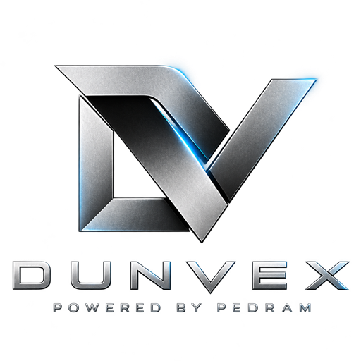

<div align="center">



**A light, all-in-one VPN panel: every line, one interchange.**
Xray + sing-box · 26 ready protocols · per-user accounting · one-line install

by **Pedram**

[فارسی](#فارسی) · [English](#english)

</div>

---

## English

### Install (one line)

```bash
bash <(curl -Ls https://raw.githubusercontent.com/pedramrj/Dunvex/main/install.sh)
```

Ubuntu, Debian, CentOS/Alma/Rocky, Fedora, Arch · amd64 & arm64 · root.
At the end you get the panel address, username and password (also saved in `/usr/local/dunvex/install-info.txt`).
The first install already serves **VLESS Reality** and **Hysteria2**: add a user and share the link.

Manage from SSH: `dunvex menu` · Update: same command with `update` · Remove: `uninstall`.

The installer shows the DV logo, a live step log with download progress and checksum check, and ends with the
login details and a QR code of the panel address. `dunvex menu` is a full-screen control centre built with Bubble Tea:
a gradient Dunvex header, navigation, a live dashboard (big CPU/RAM/disk numbers, download and upload charts,
24-hour traffic, users, protocols, recent events), users, protocols, live logs, backups, service actions, network and
a login card with QR code. Ctrl+P opens a command palette; risky actions ask first; mouse works too. Plain output: `DUNVEX_PLAIN=1`. GitHub blocked on the server? Copy the binary over
and install it offline with `DUNVEX_BINARY=/root/dunvex bash install.sh`.

### What you get
- **26 protocol presets**, all validated against the real cores (Xray 26.11, sing-box 1.14):
  VLESS Reality (Vision · XHTTP · gRPC · universal), XHTTP/WS/HTTPUpgrade/gRPC over TLS (CDN),
  post-quantum VLESS Encryption, Hysteria2, TUIC v5, WireGuard, AnyTLS, ShadowTLS v3, NaiveProxy,
  Shadowsocks 2022, Trojan, VMess, mKCP, SOCKS5, HTTP. See [docs/PROTOCOLS.md](docs/PROTOCOLS.md).
- **Users**: data limit, expiry, start-on-first-connection, daily/weekly/monthly reset, per-protocol access, bulk actions.
- **Live changes**: adding, limiting or renewing a user reaches Xray at once, without disconnecting anyone else.
- **Device limit**: set how many devices may connect at once; the panel shows each user's connected addresses.
- **Admins**: owner, admin and reseller roles (resellers manage only their own users, within a user and data quota), two-step login (TOTP).
- **Telegram bot**: status, users, one-line new user, renew, backup, alerts and a daily report; users get usage warnings.
- **Exact per-user usage** across both cores, hourly history, live speed, who is online.
- **Subscription** that adapts to the app: links, Clash Meta, sing-box JSON, plus a user page with QR codes and one-tap import (Hiddify, v2rayNG, Happ, Streisand, V2Box, Shadowrocket, NekoBox, sing-box, Clash).
- **Control-room panel (v1.2)**: KPI cards with live sparklines, a neon network topology and world map, CPU gauge,
  zoomable analytics with CSV export, live logs, an alert centre, a security page and a full-screen mission wall.
  Ctrl/Cmd+K command palette, Navy / OLED / Light themes, density and Persian-font choice, presentation mode that
  blurs every secret, and a short intro. Persian (RTL) and English, phones included, WCAG AA contrast.
- **Self-healing**: a busy port only pauses that one protocol; a crashed core restarts itself.
- Reality keys and SNI tester, Let's Encrypt or self-signed (pinned) certificates, backup & restore, self-update.

### License
Dunvex is licensed under the **GNU AGPL-3.0-or-later**, © 2026 Pedram. Anyone who changes Dunvex, or runs a changed
version for other people, must publish its full source under the same license and keep the author's name.
The Dunvex name and logo are not covered by the AGPL. See [LICENSE](LICENSE) and [NOTICE](NOTICE).

### Build from source
```bash
cd web && npm ci && npm run build && cd ..
go build -o dunvex ./cmd/dunvex
```

---

## فارسی

### نصب با یک دستور

```bash
bash <(curl -Ls https://raw.githubusercontent.com/pedramrj/Dunvex/main/install.sh)
```

در پایان آدرس پنل، نام کاربری و رمز نمایش داده می‌شود (در `/usr/local/dunvex/install-info.txt` هم ذخیره می‌شود).
بعد از نصب، **VLESS Reality** و **Hysteria2** آماده‌اند؛ فقط کاربر بسازید و لینک را بفرستید.

مدیریت از SSH: ‏`dunvex menu` · به‌روزرسانی: همان دستور با `update` · حذف: `uninstall`.

نصب‌کننده لوگوی DV، گزارش زندهٔ مراحل با نوار دانلود و بررسی checksum را نشان می‌دهد و در پایان اطلاعات ورود و QR آدرس پنل را می‌دهد.
‏`dunvex menu` یک مرکز کنترل تمام‌صفحه با کلیدهای جهت است: وضعیت زندهٔ سرویس، هسته‌ها، CPU، RAM، دیسک، شبکه و کاربران،
به‌علاوهٔ ری‌استارت، فهرست کاربران، لاگ زنده، بازنشانی مدیر، پورت پنل، پشتیبان، به‌روزرسانی و تنظیمات شبکه.
اگر گیت‌هاب روی سرور بسته است، فایل باینری را منتقل کنید و با `DUNVEX_BINARY=/root/dunvex bash install.sh` نصب کنید.

### امکانات
- **۲۶ پروتکل آماده** که همه با هسته‌های واقعی تست شده‌اند (فهرست کامل در [docs/PROTOCOLS.md](docs/PROTOCOLS.md)).
- **کاربران**: حجم، تاریخ انقضا، شروع از اولین اتصال، صفر شدن دوره‌ای، محدودیت پروتکل، عملیات گروهی.
- **تغییر زنده**: ساختن، محدود کردن یا تمدید کاربر بدون قطع شدن بقیه اعمال می‌شود.
- **محدودیت دستگاه**: تعداد دستگاه هم‌زمان هر کاربر، با نمایش IPهای متصل.
- **مدیران**: نقش مالک، مدیر و نماینده فروش (با سقف کاربر و حجم) و ورود دو مرحله‌ای.
- **ربات تلگرام**: وضعیت سرور، مدیریت کاربران، پشتیبان، هشدار و گزارش روزانه؛ کاربران هم هشدار مصرف می‌گیرند.
- **مصرف دقیق هر کاربر**، تاریخچهٔ ساعتی، سرعت لحظه‌ای، کاربران آنلاین.
- **اشتراک هوشمند** برای همهٔ برنامه‌ها + صفحهٔ کاربر با QR و افزودن یک‌لمسی.
- **پنل اتاق کنترل (نسخهٔ ۱.۲)**: کارت‌های آماری با نمودار زنده، توپولوژی نئونی شبکه و نقشهٔ جهان، گیج پردازنده،
  تحلیل ترافیک با زوم و خروجی CSV، لاگ زنده، مرکز اعلان‌ها، صفحهٔ امنیت و حالت دیوار نمایش.
  پالت فرمان با Ctrl+K، پوستهٔ سرمه‌ای، OLED و روشن، انتخاب فونت فارسی، حالت ارائه که اطلاعات حساس را محو می‌کند و اینترو.
- **خودترمیم**: اگر پورتی اشغال باشد فقط همان پروتکل متوقف می‌شود.

نقشهٔ راه: [docs/ROADMAP.md](docs/ROADMAP.md)

### لایسنس
Dunvex تحت لایسنس **GNU AGPL-3.0** و متعلق به Pedram است. هر کس آن را تغییر دهد یا نسخهٔ تغییریافته را
به‌صورت سرویس در اختیار دیگران بگذارد، باید کد کامل همان نسخه را با همین لایسنس منتشر کند و نام سازنده را حفظ کند.
نام و لوگوی Dunvex شامل این لایسنس نیستند.

---

Dunvex © 2026 Pedram · AGPL-3.0-or-later. Cores (Xray-core, sing-box) are downloaded at install time and keep their own licenses; see [NOTICE](NOTICE).
