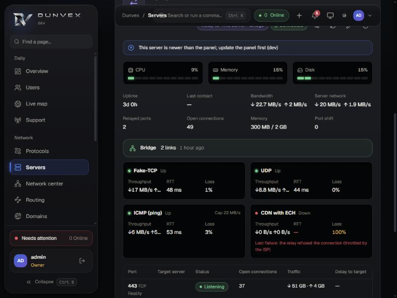
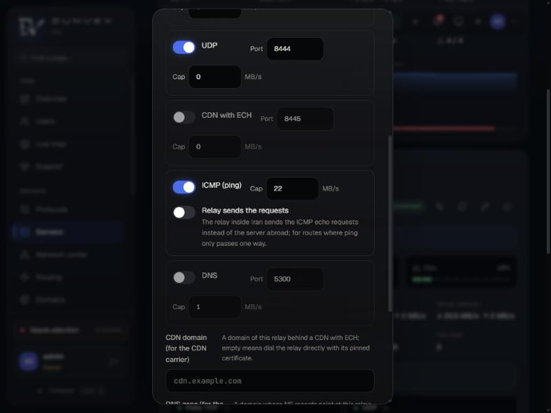
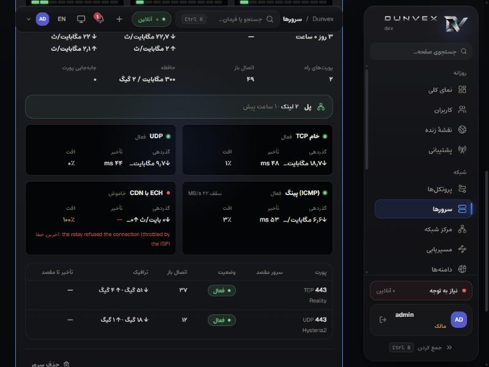

# The Dunvex Bridge (engine, phase 1)

The Bridge is a resilient, encrypted, multi-carrier tunnel between two Dunvex
servers we own: one inside Iran (the **relay**) and one abroad (the **target**).
Users keep their normal apps and connect to the Iranian relay with the usual
protocols (Reality, Hysteria2, SSH and the rest) — that traffic stays inside the
country. The relay carries their bytes across the border to the target through
the Bridge, over whichever carriers are getting through right now. Because we own
both ends, the carriers can be unusual (raw ICMP, our own TCP, DNS) and need no
support in the user's app.

It exists because, by late 2026, no single protocol survives in Iran: filtering
has moved toward a whitelist (a source-IP allowlist during shutdowns, SNI
blocklists with SNI-to-DNS consistency checks, DPI that reassembles fragmented
ClientHellos, RSTs after Reality handshakes), and on some routes only ICMP
passes. The Bridge's answer is not a better single trick but many carriers at
once, measured every second, with the stream failing over to the healthy ones
faster than the filter can react.

## How it fits Dunvex

Dunvex already has relay servers and reverse tunnels (`internal/relay`, the nodes
in `internal/node`, the Servers page). The Bridge is a **new relay mode,
`bridge`**, beside `forward` and `reverse`. It keeps the reverse tunnel's exact
shape:

- the relay inside Iran opens [smux](https://github.com/xtaci/smux) streams for
  the forwarded ports (every protocol of the target, same ports, TCP and UDP),
- the target abroad accepts those streams and connects them to its own protocols,
- the real client IP is preserved for device limits, exactly as relays already do.

The only thing that changes under smux is the transport. Instead of one
pinned-TLS link, the Bridge gives smux a `net.Conn` built as

```
smux  ->  kcp (reliability over lossy carriers)  ->  Transport (multi-carrier)
```

the same pattern the repo already uses for DNS tunnels (kcp + smux over a packet
conn, `internal/dnstt`). So every protocol a relay can forward works over the
Bridge with no per-protocol work, and links that point at the Iranian relay keep
working with every app.

Direction: the target **abroad** is the Bridge client that dials the carriers
toward the relay in Iran (abroad→Iran, the direction filtering leaves alone more
often), and the relay answers. Most of a user's download therefore rides the easy
way, and the constrained Iran→abroad answers are paced under the reported volume
triggers.

## The session layer (`internal/bridge/session.go`)

- **Probe resistance.** The client's opening frame is sealed with a key derived
  from the pre-shared key alone, so without the PSK no valid handshake can be
  forged and the server answers **nothing at all** — no error, no RST, no packet.
  A scanner sees a silent host. A **replayed** handshake is handled too: the
  server remembers the ephemeral keys it has seen and never installs a second
  session from one (which would reset the counter and reuse record nonces), and
  it re-answers only the genuine client still re-sending its Init (same carrier,
  a few seconds), so a replay prober — the kind the GFW runs — gets silence.
- **Authentication + forward secrecy.** The session key mixes the PSK with
  X25519(client ephemeral, relay static). The PSK authenticates; the ephemeral
  gives forward secrecy against a later PSK leak. (A static-key compromise is not
  covered — that would need a server ephemeral and a second round trip, i.e. full
  Noise IK; a later hardening.)
- **Records.** Each frame is ChaCha20-Poly1305 with a per-direction counter nonce
  (never repeats under one key), and the 16-byte sid+seq header is masked
  QUIC-style from the ciphertext, so frames look like random bytes end to end. The
  handshake reply is sealed under a separately derived key, so it never shares the
  record nonce space.
- **Replay protection.** A wide sliding window (4096) drops replays while
  tolerating the deep reordering of frames striped across carriers of very
  different RTT; a different session has a different key, so a captured frame can
  never be replayed into another session.
- **Shaping.** Data frames are padded to a few size buckets (a full data frame
  lands on the top bucket, so bulk packets are not padded while small ones hide
  among a handful of sizes), and the Init and Resp are padded too, so the
  handshake has no fixed size to fingerprint.

## The carriers (`internal/bridge/carrier_*.go`)

Each carrier is a small, independent driver that only moves opaque frames
best-effort; the encryption, health, pacing and failover all sit above it. Turn
on any set.

| Carrier | Why | Weak point |
| --- | --- | --- |
| **ICMP** (raw sockets) | On the worst days reported, echo was the only thing crossing (net4people #676). A `server-sends-requests` option follows #676's workaround for one-way echo blocks. | ~50k pps cap and a reroute above ~30 MB/s, so it is paced well under (default 22 MB/s). Linux only. |
| **fake-TCP** (raw sockets, paqet-style) | We build our own TCP-looking packets (net4people #570); a firewall rule drops the kernel's RSTs on the port, so stateful DPI sees ordinary PSH/ACK and nothing to lock onto. | Needs root and both ends; Linux only. Prior art read, read-only: `github.com/hanselime/paqet`. |
| **UDP** | The fastest carrier when UDP is open; random-looking framing and padding. | First to die when the filter blocks UDP. |
| **TLS via a CDN with ECH** | WebSocket inside TLS with Encrypted Client Hello from the CDN name's DNS HTTPS record (reuses Dunvex's `ech_cdn` lookup). Reached tens of MB/s on some routes. | Throttled to a crawl on at least one phone ISP; depends on the ECH name being allowed. |
| **DNS** | The last resort in a full shutdown; reuses the in-repo dnstt. | Slow, for keeping a thin link alive. |

## The scheduler (`internal/bridge/transport.go`)

Probes every second give each carrier a live state — up/down, RTT, loss, last
failure. kcp packets ride the healthiest carrier whose per-carrier cap still has
room; a carrier that misses a few probes in a row is marked down and dropped from
the choice within ~3 seconds, and because kcp retransmits on the next healthy
carrier, **open streams survive a carrier dying**. Each carrier has a byte-rate
cap (a token bucket), plus jitter and padding, so traffic stays under volume
triggers.

## Panel

On the Servers page, a Bridge relay's card shows every carrier live — a state
LED, throughput, RTT, loss and the last failure — in the Signal Console style,
and the settings let you turn carriers on or off and set their ports and caps.





کنسول حامل‌های پل و تنظیمات آن‌ها، به فارسی:



## Setting one up

1. Install the node on both servers (`bash <(curl … ) node`), as for any relay.
2. In the panel, **Servers → Add server**, paste the Iranian server's token,
   choose **Relay**, set the mode to **Bridge**, and pick the target (this
   server, or another node abroad). Turn on the carriers you want and set their
   ports and caps. The panel generates the Bridge keys and the pre-shared key and
   pushes them to both ends.
3. The relay comes up listening on its carriers; the target abroad dials it and
   the Bridge session forms. The card then shows every carrier live.

The DNS carrier needs a zone whose NS records point at the relay; the CDN carrier
needs a CDN-fronted domain for the relay (empty means dial the relay directly
with its pinned certificate).

## Test results (hostile-network namespaces)

The Bridge was tested without an Iranian server, in two Linux network namespaces
("iran" and "abroad") joined by a veth pair, with the iran side playing the
border: it drops or limits protocols to reproduce the reported filtering while a
long download runs abroad→iran, and we watch the Bridge keep it going on whatever
still gets through. (`internal/bridge/lab` + the test script; carriers ICMP,
fake-TCP, UDP and TLS-CDN; the DNS carrier is covered by the Go tests.)

| Scenario | What the border did | Carried by | Throughput | Max reorder |
| --- | --- | --- | --- | --- |
| **Baseline** | nothing | fake-TCP | 78.9 MB/s | 58 |
| **Only ICMP passes** | TCP and UDP cut | ICMP, paced to its cap | 21.4 MB/s | 3 |
| **UDP blocked** | UDP dropped | fake-TCP | 74.5 MB/s | 73 |
| **RST after the TLS handshake** | the CDN carrier's port cut | fake-TCP (+ UDP) | 89.1 MB/s | 15 |
| **Loss + rate cap** (≈40 Mbit/s, 3% loss on the download path) | shaped link | fake-TCP / UDP | 3.4 MB/s | 3 |

In **only ICMP**, every other carrier is down (100% probe loss) and ICMP alone
carries the download, held at **21.4 MB/s** — its 22 MB/s cap biting, so the
carrier stays under the ~30 MB/s volume-reroute trigger the research reports
(net4people #676). In **RST after the TLS handshake**, the CDN carrier is dead
but the others never notice. The loss+cap row shows the Bridge delivering a
steady 3.4 MB/s through a 40 Mbit/s link with 3% loss.

The **max reorder** column is how far out of order a frame arrived and was still
accepted (the replay window's high-water mark). With several carriers of very
different RTT active at once, it reached **101** in the resilience run — above the
64 a narrow window would allow, so the replay window is sized at 4096 to avoid
dropping legitimate frames and forcing needless kcp retransmits.

**Resilience — one long download while carriers die and come back** (40 s,
carriers ICMP + fake-TCP + UDP): 2.7 GB delivered, **68.9 MB/s average** across
two carrier-kill events:

- at ~t5, **fake-TCP and UDP are cut**: the download stalls for **~2 seconds**,
  then fails over to **ICMP** and resumes at its 22 MB/s cap — the open stream
  survives;
- at ~t17, the carriers are **restored**: throughput climbs back to ~80–90 MB/s on
  fake-TCP with **no stall** (a recovered carrier rejoins seamlessly);
- at ~t20, **ICMP is cut**: **no stall at all**, because fake-TCP and UDP were
  already carrying the stream.

These are loopback-veth numbers — upper bounds, not Iran speeds. What they show is
the behaviour: the download keeps going on whatever still passes the border, the
failover is a couple of seconds, a recovered carrier rejoins without a hiccup, and
the ICMP cap holds the carrier under its reroute trigger.

The Go tests also prove the handshake, probe resistance (a wrong key gets
silence), replay rejection, header protection, a full smux-over-kcp-over-UDP
transfer, and failover when a carrier dies mid-transfer: `go test ./internal/bridge/`.

## Limits

No tool stays hidden forever. The aim is to make detection expensive and slow and
to let Dunvex change faster than the filter. During a full shutdown with a
source-IP allowlist, a user whose IP is not allowed cannot reach abroad at all;
the Iranian relay helps only while the user can still reach it (domestic traffic),
which is usually the case. The raw-socket carriers (ICMP, fake-TCP) are
Linux-only; both production ends run Linux.

---

# پل Dunvex (موتور، فاز ۱)

پل یک تونل مقاوم، رمزگذاری‌شده و چندحامله بین دو سرور خودمان است: یکی داخل ایران
(**رله**) و یکی خارج (**مقصد**). کاربر مثل همیشه با اپ‌های معمولی (Reality،
Hysteria2، SSH و بقیه) به سرور داخل ایران وصل می‌شود؛ این ترافیک داخل کشور می‌ماند.
رله بایت‌های او را از راه پل و از سالم‌ترین حامل‌ها از مرز به سرور خارج می‌رساند.
چون هر دو سر دست ماست، حامل‌ها می‌توانند غیرعادی باشند (پینگ خام، TCP دست‌ساز، DNS)
و به اپ کاربر وابسته نیستند.

دلیلش این است که تا اواخر ۲۰۲۶ هیچ پروتکل تکی در ایران دوام نمی‌آورد: فیلترینگ به
سمت فهرست سفید رفته (فهرست IP مبدأ در قطعی‌ها، بلاک‌لیست SNI با تطبیق SNI و DNS،
DPIای که تکه‌های ClientHello را سرهم می‌کند، RST بعد از دست‌دهی Reality) و روی بعضی
مسیرها فقط پینگ رد می‌شود. پاسخ پل یک ترفند بهتر نیست، بلکه چند حامل هم‌زمان است که
هر ثانیه سنجیده می‌شوند و ترافیک سریع‌تر از واکنش فیلتر روی حامل سالم می‌رود.

## جای آن در Dunvex

Dunvex از قبل رله و تونل معکوس دارد (`internal/relay`، نودها در `internal/node`،
صفحهٔ سرورها). پل یک **حالت رلهٔ تازه به نام `bridge`** کنار `forward` و `reverse`
است و دقیقاً شکل تونل معکوس را نگه می‌دارد: رلهٔ داخل ایران برای پورت‌های فوروارد
جریان‌های smux باز می‌کند، مقصد خارج آن‌ها را می‌پذیرد و به پروتکل‌های خودش وصل
می‌کند، و IP واقعی کاربر برای محدودیت دستگاه حفظ می‌شود. تنها چیزی که زیر smux عوض
می‌شود حمل‌ونقل است: به‌جای یک لینک TLS، پل یک `net.Conn` می‌دهد که از
`smux → kcp (اطمینان روی حامل‌های پرافت) → حمل‌ونقل چندحامله` ساخته شده — همان الگویی
که Dunvex برای تونل‌های DNS به کار می‌برد. پس هر پروتکلی که رله فوروارد می‌کند بدون
کار جداگانه روی پل کار می‌کند.

جهت: مقصد **خارج** سمت کلاینت پل است و حامل‌ها را به‌سمت رلهٔ داخل ایران باز می‌کند
(خارج→ایران، جهتی که فیلتر بیشتر رهایش می‌کند) و رله جواب می‌دهد. پس بیشتر دانلود
کاربر از راه آسان می‌رود و جواب‌های جهت سخت (ایران→خارج) زیر آستانه‌های حجمی تنظیم
می‌شوند.

## لایهٔ جلسه

- **بی‌جواب برای کاوشگر:** فریم آغازین با کلیدی که فقط از کلید مشترک ساخته می‌شود
  مهر می‌شود؛ بدون آن کلید هیچ دست‌دهی معتبری ساخته نمی‌شود و سرور **هیچ جوابی**
  نمی‌دهد (نه خطا، نه RST، نه بسته). کاوشگر یک میزبان خاموش می‌بیند.
- **احراز هویت و رازداری پیش‌رو:** کلید جلسه، کلید مشترک را با
  X25519(کلید گذرای کلاینت، کلید ثابت رله) ترکیب می‌کند. کلید مشترک احراز می‌کند و
  کلید گذرا در برابر لو رفتن بعدی کلید مشترک رازداری پیش‌رو می‌دهد. (لو رفتن کلید
  ثابت پوشش داده نمی‌شود؛ آن نیاز به Noise IK کامل دارد و بعداً.)
- **رکوردها:** هر فریم با ChaCha20-Poly1305 و nonce شمارنده در هر جهت (که زیر یک
  کلید تکرار نمی‌شود)؛ هدر ۱۶ بایتی به سبک QUIC از متن رمز پوشانده می‌شود تا فریم‌ها
  سرتاسر شبیه بایت تصادفی باشند.
- **ضد بازپخش:** پنجرهٔ لغزان بازپخش را رد می‌کند؛ هر جلسه کلید جداگانه دارد.
- **شکل‌دهی:** فریم‌ها تا چند اندازهٔ ثابت پر می‌شوند تا بسته‌های کوچک بین چند اندازه
  پنهان شوند.

## حامل‌ها

هر حامل یک درایور کوچک و مستقل است که فقط فریم‌ها را جابه‌جا می‌کند؛ رمزگذاری،
سلامت، تنظیم سرعت و جابه‌جایی بالای آن است. هر مجموعه‌ای را می‌شود روشن کرد.

| حامل | چرا | نقطهٔ ضعف |
| --- | --- | --- |
| **پینگ (ICMP)** | در بدترین روزها تنها چیزی بود که رد شد (#676). گزینهٔ «درخواست از سمت رله» راه‌حل #676 برای بلاک یک‌طرفهٔ پینگ است. | سقف ~۵۰k بسته/ثانیه و تغییر مسیر بالای ~۳۰ مگابایت/ثانیه؛ پس خوب زیر آن نگه داشته می‌شود (پیش‌فرض ۲۲). فقط لینوکس. |
| **TCP خام (مثل paqet)** | بسته‌های TCP را خودمان می‌سازیم (#570)؛ یک قانون فایروال RST کرنل را روی آن پورت می‌اندازد تا DPI حالت‌دار الگوی آشنا نبیند. | root و هر دو سر لازم است؛ فقط لینوکس. |
| **UDP** | سریع‌ترین حامل وقتی UDP باز است؛ قاب و پرکردن تصادفی. | اولین قربانی وقتی UDP بسته شود. |
| **CDN با ECH** | وب‌سوکت در TLS با ECH از رکورد HTTPS نام CDN. روی بعضی مسیرها ده‌ها مگابایت/ثانیه. | روی دست‌کم یک اپراتور موبایل خیلی کند شد؛ به مجاز بودن نام ECH بستگی دارد. |
| **DNS** | آخرین راه در قطعی کامل؛ از dnstt موجود. | کند، برای زنده نگه‌داشتن یک لینک نازک. |

## زمان‌بند

هر ثانیه سنجش، به هر حامل حالت زنده می‌دهد (روشن/خاموش، تأخیر، افت، آخرین خطا).
بسته‌های kcp روی سالم‌ترین حاملی می‌روند که سقفش جا دارد؛ حاملی که چند سنجش پشت هم را
از دست بدهد ظرف ~۳ ثانیه خاموش علامت می‌خورد و از انتخاب کنار می‌رود، و چون kcp روی
حامل بعدی بازارسال می‌کند، **جریان‌های باز با مردن یک حامل قطع نمی‌شوند**. هر حامل سقف
سرعت دارد، به‌علاوهٔ لرزش و پرکردن، تا زیر آستانه‌های حجمی بماند.

## پنل

در صفحهٔ سرورها، کارت رلهٔ پل هر حامل را زنده نشان می‌دهد — LED وضعیت، گذردهی، تأخیر،
افت و آخرین خطا — به سبک Signal Console، و تنظیمات اجازه می‌دهد حامل‌ها را روشن/خاموش
کنی و پورت و سقفشان را بگذاری (تصاویر بالا).

## راه‌اندازی

۱. نود را روی هر دو سرور نصب کن (مثل هر رله). ۲. در پنل، **سرورها ← افزودن سرور**،
توکن سرور ایران را بچسبان، **رله** را انتخاب کن، حالت را روی **پل** بگذار و مقصد را
انتخاب کن (همین سرور یا نودی در خارج). حامل‌ها را روشن کن و پورت و سقف بده؛ پنل
کلیدهای پل و کلید مشترک را می‌سازد و به هر دو سر می‌فرستد. ۳. رله روی حامل‌هایش گوش
می‌دهد، مقصد خارج به آن وصل می‌شود و پل برقرار می‌شود.

## نتیجهٔ آزمایش

پل بدون سرور ایران، در دو namespace شبکهٔ لینوکس («iran» و «abroad») که با یک جفت
veth به هم وصل‌اند آزمایش شد؛ سمت iran نقش مرز را بازی می‌کند و پروتکل‌ها را می‌اندازد
یا محدود می‌کند تا فیلترینگ گزارش‌شده را بازسازی کند، در حالی که یک دانلود بلند از
خارج به ایران جریان دارد. جدول نتیجه‌ها بالا در بخش انگلیسی است.

## محدودیت‌ها

هیچ ابزاری برای همیشه پنهان نمی‌ماند؛ هدف این است که تشخیص گران و کند باشد و Dunvex
سریع‌تر از فیلتر عوض شود. در قطعی کامل با فهرست سفید IP، کاربری که IPش مجاز نیست اصلاً
به خارج نمی‌رسد؛ رلهٔ ایران فقط تا وقتی کمک می‌کند که کاربر بتواند به آن برسد. حامل‌های
سوکت خام (پینگ، TCP خام) فقط لینوکس‌اند؛ هر دو سر تولید لینوکس‌اند.
